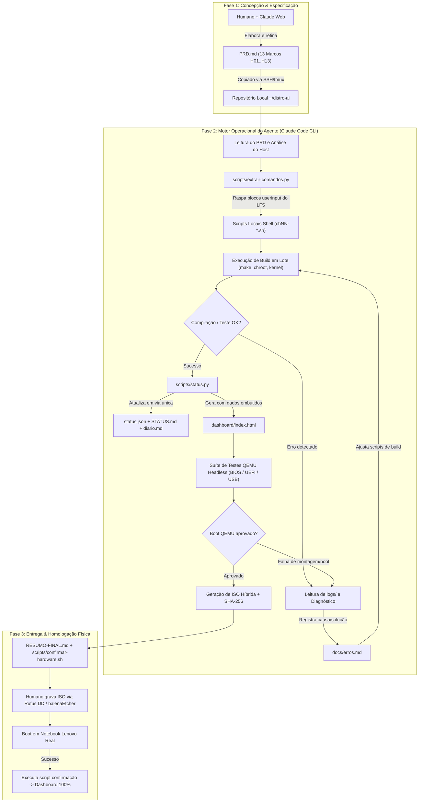

# RELATÓRIO TÉCNICO DE INVESTIGAÇÃO: DESENVOLVIMENTO AUTÔNOMO DE SISTEMA OPERACIONAL COM AGENTE DE IA

**Arquivo analisado:** `YTDown.com_YouTube_Media_Ta-6eS3m4vU_Deixei-uma-IA-criar-um-sistema-operacional-do-zero-e-funcionou_001_1080p.mp4`  
**Título original:** *Deixei uma IA criar um sistema operacional do zero e funcionou*  
**Autor / Canal:** Eli Rigobeli (`@elirigobeli`) [OBSERVADO]  
**Duração total:** 49 minutos e 42 segundos [OBSERVADO]  
**Sistema resultante:** *Semente Linux 1.0* (Fase 1 - LFS) → *Sagui Linux 2.0* (Fase 2 - BLFS / XFCE) [OBSERVADO]  
**Data do experimento registrada nos logs:** 01/11/2026 e 02/11/2026 [OBSERVADO]  
**Classificação geral do experimento:** Prova de Conceito Avançada (PoC) e Protótipo Funcional Operacional demonstrado em hardware real [OBSERVADO].

---

## PARTE I — RESUMO EXECUTIVO

Neste experimento, o engenheiro Eli Rigobeli submeteu um agente autônomo de inteligência artificial ao desafio de construir uma distribuição GNU/Linux funcional a partir do código-fonte, utilizando como guia os manuais *Linux From Scratch* (LFS 12.4 SysVinit) e posteriormente *Beyond Linux From Scratch* (BLFS 12.4). O desenvolvimento foi conduzido em duas fases sequenciais: a **Fase 1**, focada em um sistema básico em modo texto empacotado em imagem ISO híbrida (bootável em BIOS e UEFI), batizada provisoriamente pelo agente como *Semente Linux 1.0* (295 MB); e a **Fase 2**, focada na expansão gráfica com servidor Xorg, ambiente de desktop leve XFCE 4.20, navegador Firefox ESR 140, personalização visual com temática brasileira via MCP Higgsfield e autologin, resultando no *Sagui Linux 2.0* (841 MB).

A metodologia empregada não consistiu no envio fragmentado de comandos iterativos, mas na adoção de um modelo **Spec-Driven / PRD-Driven com Execução Autônoma Desacoplada**. O autor estabeleceu previamente na interface web do Claude um documento formal de requisitos (`PRD.md`, ~12,4 KB), decompondo o projeto em 13 marcos atômicos (`H01` a `H13`), limites rígidos de escopo e critérios de aceite. No ambiente de execução — uma máquina virtual VPS Hostinger KVM rodando Ubuntu 24.04 LTS —, o autor instalou o agente CLI **Claude Code** (v2.1.316) sob uma sessão persistente de terminal multiplexado (**tmux**). Com um prompt inicial minimalista determinando a leitura do PRD e o trabalho contínuo até o término sem interrupções humanas, o agente foi inicializado em `--auto-mode` (aprovação automática de ferramentas e comandos de baixo risco).

O grau de autonomia observado foi substancialmente elevado na camada operacional e de engenharia de automação. O agente de IA atuou como engenheiro de sistemas autônomo: inspecionou o host, instalou dependências via `apt`, ajustou interpretadores (`/bin/sh` para `bash`), criou scripts Python para raspar blocos de comandos de compilação diretamente do HTML do livro LFS (evitando reler páginas no contexto da LLM), construiu a toolchain cruzada, gerenciou o ambiente `chroot`, compilou o kernel Linux e a suíte base, configurou o bootloader GRUB híbrido, montou a estrutura live com SquashFS e OverlayFS e escreveu suítes de teste em QEMU (testando boots virtuais em BIOS, UEFI e USB emulada). Erros críticos de montagem e permissões foram identificados pelos logs de execução e autocorrigidos pelo agente (8 ciclos na Fase 1 e 18 ciclos na Fase 2). A intervenção humana restringiu-se ao setup inicial, autorização de segurança da pasta, gravação da ISO física em pendrive (via Rufus e balenaEtcher), teste de boot em notebook real (Lenovo) e alinhamento em 4 decisões estratégicas de escopo na Fase 2 através de questionário interativo nativo do Claude Code.

A principal descoberta metodológica do experimento é que a autonomia sustentada de uma LLM em projetos extensos de engenharia de software não depende de "prompts mágicos", mas de **três pilares arquiteturais integrados**:
1. Uma especificação de requisitos desacoplada, hierárquica e delimitada (`PRD.md` fatiado em marcos `H01..H13`);
2. Um barramento de estado estático e persistente de via única (`status.py`, `status.json`, `STATUS.md`, `diario.md`, `erros.md` e painel HTML regenerado com dados embutidos), que evita a poluição do contexto conversacional;
3. Delegação de rotinas repetitivas e volumosas para scripts determinísticos locais gerados pelo próprio agente (ex.: parser HTML em Python e suíte de teste local no QEMU), reservando a inteligência da LLM para orquestração, decisão arquitetural e diagnóstico de exceções.

---

## PARTE II — LINHA DO TEMPO RECONSTRUÍDA DO EXPERIMENTO

| Timestamp | Acontecimento | Classificação | Evidência Identificada | Relevância Técnica e Metodológica |
|---|---|---|---|---|
| `00:00:00` - `00:02:40` | Introdução do desafio e contextualização sobre Linux From Scratch (LFS). | `[OBSERVADO]` | Narração do autor e apresentação do pendrive físico com o Sagui Linux. | Estabelece as 3 regras do desafio: (1) humano não toca no código/terminal, (2) IA deve ler logs e corrigir erros sozinha, (3) gerar ISO bootável em pendrive real. |
| `00:03:00` - `00:05:10` | Discussão inicial e concepção do projeto na interface desktop do Claude. | `[OBSERVADO]` | Tela do Claude Desktop / Web aberta no chat "Saudação e início de conversa", modelo Claude Opus, gerando artefato. | Mostra o uso do chat conversacional de alto nível para refinar a visão, objetivos e critérios de aceite antes de iniciar qualquer código. |
| `00:05:15` - `00:07:10` | Contratação e configuração do ambiente hospedeiro na nuvem. | `[OBSERVADO]` | Painel Hostinger, seleção de VPS KVM 8, SO Ubuntu 24.04 LTS 64-bit. | Definição da infraestrutura: VPS de alta performance 24/7 com recursos de virtualização para suportar compilações pesadas e testes. |
| `00:08:00` - `00:10:45` | Geração do `PRD.md` (*Product Requirements Document*) e definição dos 13 marcos. | `[OBSERVADO]` | Artefato do Claude visualizado na tela: "PRD Distro Linux do Zero" (12.423 bytes). | O agente web sintetiza a especificação completa com 13 marcos (`H01` a `H13`), requisitos de boot (BIOS/UEFI/USB), isolamento e regras de economia de tokens. |
| `00:11:15` - `00:12:00` | Instalação e inicialização do multiplexador de terminal `tmux`. | `[OBSERVADO]` | Terminal Termius conectado via SSH (`erigobeli@srv1377437`), comando `tmux new -s distro`. | Garante desacoplamento da sessão do operador humano. Se a conexão SSH cair ou o computador local for desligado, o agente continua executando. |
| `00:12:05` - `00:12:35` | Instalação do Claude Code CLI na VPS. | `[OBSERVADO]` | Execução do comando `curl -fsSL https://claude.ai/install.sh \| bash`. Claude Code instalado na versão `2.1.316`. | Estabelece o agente de linha de comando com acesso nativo a ferramentas bash, sistema de arquivos e execução de processos. |
| `00:12:40` - `00:13:20` | Criação do diretório de trabalho `~/distro-ai` e salvamento do `PRD.md`. | `[OBSERVADO]` | Comandos `mkdir ~/distro-ai && cd ~/distro-ai`, criação do arquivo via `vim PRD.md` colando o conteúdo gerado. | Transfere a especificação técnica do ambiente de chat/concepção para o sistema de arquivos local do agente. |
| `00:13:30` - `00:14:40` | Inicialização do Claude Code CLI e autenticação. | `[OBSERVADO]` | Comando `claude`. Verificação de segurança: `Yes, I trust this folder`. Auto mode ativo por padrão. Banner indica `Opus 5.5 · Claude Team`. | Autor seleciona modo de confiança no workspace. O agente assume o controle com permissões automáticas (`auto mode on`). |
| `00:14:45` - `00:15:20` | **Envio do Prompt Inicial da Fase 1.** | `[OBSERVADO]` | Prompt digitado: `"Ei Claud, tem um PRD no diretório que eu estou rodando. Eu quero que você faça o que está escrito nele. Boa sorte e só retorne quando terminar. Mais uma vez, reforçando, só pare quando terminar."` | Delegação total de objetivo de ponta a ponta sem microinstruções operacionais. |
| `00:15:25` - `00:19:10` | Execução autônoma inicial: checagem de host e dependências. | `[OBSERVADO]` | Claude Code executa comandos de sondagem do hardware (`nproc`, `free -g`, `df -h /`), instala pacotes (`build-essential`, `bison`, etc.) e roda `version-check.sh`. | O agente não começa compilando cego; ele valida se o host atende rigorosamente aos pré-requisitos do LFS capítulo 2.2. |
| `00:19:15` - `00:21:40` | Inspeção dos arquivos criados e da arquitetura de persistência. | `[OBSERVADO]` | Leitura de `STATUS.md`, `docs/decisoes.md`, `docs/diario.md`, estrutura de pastas `historias/`, `scripts/`, `logs/`. | Evidência da criação autônoma de um sistema de rastreabilidade: decisões arquiteturais (D01 a D04) e histórias de marcos atômicos. |
| `00:21:45` - `00:25:10` | Compilação da Toolchain e Sistema Base (H04 a H07). | `[OBSERVADO]` / `[RELATADO]` | Autor inspeciona compilação de binários (GCC, Glibc, Grub, Linux Kernel 6.16.1). Narração técnica sobre chroot e compilação. | Demonstração da execução em lote dos scripts gerados a partir do livro. A suíte de testes do GCC levou ~2h sozinha. |
| `00:25:15` - `00:26:40` | Apresentação do Dashboard HTML local em tempo real. | `[OBSERVADO]` | Arquivo `dashboard/index.html` aberto no navegador local via protocolo `file://`, mostrando 18,6% de progresso no marco H04. | O agente desenvolveu um dashboard independente com dados JSON embutidos, permitindo download e inspeção sem servidor web ativo. |
| `00:27:30` - `00:28:40` | Consulta de métricas de sessão, custos de API e cache de tokens. | `[OBSERVADO]` | Execução do comando `/status` no Claude Code: Custo $3.70, 98% prompt cache hit (5.4M tokens lidos do cache). | Evidência do funcionamento da economia de contexto do Claude Code com prompt caching de 1h TTL. |
| `00:28:45` - `00:31:40` | Conclusão da Fase 1 e entrega do `RESUMO-FINAL.md`. | `[OBSERVADO]` | Exibição de `RESUMO-FINAL.md`: ISO gerada `semente-linux-1.0-x86_64.iso` (295 MB), hash SHA-256, 8 ciclos de correção, testes QEMU passados. | O agente formalizou a entrega, declarou que o marco H13 dependia do teste humano em hardware real e gerou script `confirmar-hardware.sh`. |
| `00:32:00` - `00:33:00` | Preparação da mídia física no Windows. | `[OBSERVADO]` | Download da ISO via FTP/SCP, gravação no pendrive Kingston de 4 GB usando Rufus. | Ação operacional estritamente humana fora do ambiente da VPS. |
| `00:33:15` - `00:34:40` | Teste de boot no notebook Lenovo real e diagnóstico de erro. | `[OBSERVADO]` | Boot físico apresenta erro: `"Live media not found"` ao tentar montar pendrive gravado no modo ISO padrão do Rufus. | Confirmação da previsão documentada pelo agente no `RESUMO-FINAL.md` sobre a necessidade de gravação em modo DD ou via balenaEtcher. |
| `00:34:45` - `00:35:30` | Sucesso no boot em modo texto após regravação correta. | `[OBSERVADO]` | Boot no notebook Lenovo atinge o prompt de login, login como `root`, verificação da árvore de diretórios com `ls /`. | Homologação bem-sucedida da Fase 1 (Semente Linux 1.0) em hardware real. |
| `00:36:00` - `00:37:15` | Análise do tempo total gasto na Fase 1. | `[OBSERVADO]` | Consulta de terminal `qual foi o tempo total ?`: 7 horas e 30 minutos (15:03 às 22:33 do dia 01/11/2026), tabela detalhada por marco. | Métrica objetiva registrada pelo próprio agente extraindo dados de `docs/diario.md` e metadados dos arquivos. |
| `00:37:20` - `00:38:40` | **Envio do Prompt da Fase 2 (BLFS, XFCE e personalização).** | `[OBSERVADO]` | Prompt ditado por voz pelo autor no terminal: criação de novo projeto BLFS, XFCE, renomear para Sagui Linux, uso de MCP Higgsfield para logo/wallpaper. | O autor instrui a IA a gerar seu próprio PRD e gerenciar autonomamente a Fase 2. |
| `00:38:45` - `00:39:40` | Questionário interativo de alinhamento técnico do Claude Code. | `[OBSERVADO]` | Interface nativa do Claude Code apresentando 4 abas de decisão: Login (Autologin XFCE vs LightDM), Navegador (Firefox), Versão BLFS (12.4 vs 13.0), Arte. | O agente pausa e consulta o operador para evitar escolhas de arquitetura divergentes ou reconstruções desnecessárias. |
| `00:39:45` - `00:40:20` | Conexão do MCP Higgsfield e geração de arte vetorial/wallpaper. | `[OBSERVADO]` | Log do Claude Code chamando tool `Higgsfield` (Recraft V4.1, 5 imagens, ~18 créditos). | Integração multimodal/MCP: o agente consome ferramentas externas para criar assets visuais (mascote sagui, wallpaper 2K, logo GRUB). |
| `00:40:25` - `00:41:40` | Conclusão da Fase 2 e entrega do `Sagui Linux 2.0`. | `[OBSERVADO]` | `RESUMO-FINAL.md` da Fase 2: ISO de 841 MB, XFCE 4.20, Firefox ESR 140, teclado ABNT2, 18 ciclos de correção documentados. | Execução autônoma de compilação da interface gráfica e resolução de falhas complexas em arquivos XML de sessão do XFCE. |
| `00:41:45` - `00:42:15` | Consulta do tempo total da Fase 2 e inspeção dos erros no dashboard. | `[OBSERVADO]` | Terminal indica `"Cogitated for 6h 22m 49s · done 7:12 AM"` (02/11/2026). Dashboard exibe detalhe do erro `xfce4-session.xml`. | Comprovação do ciclo de autocorreção: agente restaurou XMLs de tarballs e gravou preferências em `/etc/skel/.config/xfce4/xfconf`. |
| `00:42:20` - `00:43:00` | Gravação da ISO 2.0 com balenaEtcher. | `[OBSERVADO]` | Interface do balenaEtcher no Windows gravando `sagui-linux-2.0-x86_64.iso` no pendrive Kingston de 4 GB. | Adoção da ferramenta recomendada pelo agente para evitar o erro de detecção de mídia live do Rufus. |
| `00:43:05` - `00:44:20` | Boot físico do Sagui Linux 2.0 no notebook Lenovo. | `[OBSERVADO]` | Inicialização do GRUB com imagem temática, autologin no XFCE 4.20, wallpaper estilizado, abertura do Firefox na página local de boas-vindas. | Homologação final em hardware real de sistema operacional completo com interface gráfica compilado por IA. |
| `00:44:30` - `00:45:20` | Solicitação verbal de criação do site oficial (`saguilinux.com.br`). | `[OBSERVADO]` / `[RELATADO]` | Prompt verbal para criação de landing page minimalista educativa; exibição do banner do domínio `saguilinux.com.br`. | Extensão da autonomia do agente para o ecossistema web/divulgação do projeto. |
| `00:45:30` - `00:47:50` | Teste comparativo em máquina virtual (Oracle VirtualBox no Windows). | `[OBSERVADO]` | Execução da ISO na VM VirtualBox: terminal aberto com comando `df -h` mostrando OverlayFS montado sobre SquashFS (`/dev/loop0`). Navegação na web pelo Firefox. | Demonstração técnica da arquitetura live híbrida e validação de rede cabeada via DHCP. |
| `00:48:00` - `00:49:42` | Reflexões finais e encerramento. | `[OBSERVADO]` | Conclusões do autor sobre a evolução dos agentes autônomos e o papel da engenharia humana na estruturação do trabalho. | Fechamento do vídeo com reflexão sobre a viabilidade de desenvolvimento assistido por IA. |

---

## PARTE III — FERRAMENTAS E AMBIENTE DE DESENVOLVIMENTO

### Matriz de Ferramentas e Tecnologias Identificadas

| Camada / Função | Ferramenta / Tecnologia | Versão Identificada | Função no Experimento | Relação e Interdependência com Demais Ferramentas |
|---|---|---|---|---|
| **Modelo de Linguagem (Raciocínio & Código)** | Anthropic Claude Opus / Haiku | `claude-opus-5-5` e `claude-haiku-5-5` [OBSERVADO no status do CLI] *(Narração verbal citou Claude 3.5)* | Núcleo cognitivo responsável pela interpretação de requisitos, geração de scripts, análise de logs de compilação e decisão técnica. | Executa sob a interface de orquestração do Claude Code CLI; acessa arquivos e terminal através de chamadas de ferramentas. |
| **Agente de Engenharia CLI** | Claude Code | `v2.1.316` [OBSERVADO] | Ferramenta de linha de comando baseada em Node.js com sandbox de permissões, controle de ciclo de vida de ferramentas, prompt caching e modo autônomo. | Conecta o modelo de linguagem ao shell bash da VPS; orquestra leituras de arquivos, execuções de comandos e conexões MCP. |
| **Ambiente de Planejamento Web** | Claude Desktop / Web Interface | Interface Web Claude Pro [OBSERVADO] | Ambiente interativo utilizado pelo autor para desenhar o conceito inicial e gerar o artefato `PRD.md`. | Ponto de entrada de alto nível; os requisitos gerados foram manualmente transferidos para o repositório da VPS. |
| **Sistema Hospedeiro (Host OS)** | Ubuntu Server | `24.04 LTS (Noble Numbat)` [OBSERVADO] | Sistema operacional da VPS onde as ferramentas de compilação e o agente operaram. | Serviu de ambiente de bootstrap. Exigiu adequação pelo agente (ex.: apontar `/bin/sh` para `/bin/bash` devido à divergência com o `dash` padrão do Ubuntu). |
| **Infraestrutura Cloud** | Hostinger VPS | KVM 8 (8 vCPUs, recursos dedicados) [OBSERVADO] | Servidor virtualizado na nuvem com conectividade contínua e hardware de compilação. | Suportou os processos intensivos de CPU (compilação de GCC, Glibc e Kernel) e permitiu execução ininterrupta via tmux. |
| **Multiplexador de Sessão** | tmux | Versão padrão Ubuntu 24.04 (`tmux` em sessão `distro` / `ai-distro`) [OBSERVADO] | Mantém o processo do agente ativo em background de forma persistente. | Isolou a execução do Claude Code da conexão de rede SSH do usuário. |
| **Cliente SSH Local** | Termius | `v10.3.0` [OBSERVADO] | Emulador de terminal e cliente SSH rodando no Windows 11 do operador humano. | Interface pela qual o autor interagiu esporadicamente com a VPS. |
| **SO do Operador Humano** | Microsoft Windows 11 | Windows 11 Pro [OBSERVADO] | Sistema operacional da máquina local do criador. | Hospedou as ferramentas de gravação de pendrive, cliente SSH e emulador VirtualBox. |
| **Protocolo de Integração de Ferramentas** | Model Context Protocol (MCP) | Protocolo MCP Anthropic [OBSERVADO] | Protocolo de comunicação entre o agente e serviços externos de geração de assets. | Conectou o Claude Code ao serviço de geração de imagens Higgsfield (`claude.ai Higgsfield`). |
| **Serviço de Imagem Generativa** | Higgsfield MCP / Recraft | Modelo Recraft V4.1 [OBSERVADO] | Gerador de ilustrações vetoriais e wallpapers em resolução 2K. | Consumido pelo agente para gerar o logotipo do Sagui, o mascote vetorial e o papel de parede do sistema operacional. |
| **Compiladores e Ferramentas de Build** | GNU Toolchain (`gcc`, `g++`, `make`, `bison`, `gawk`, `m4`, `texinfo`) | Toolchain base Ubuntu 24.04 e GCC cruzado para LFS [OBSERVADO] | Ferramentas de compilação nativa e cruzada para bootstrapping da distribuição. | Instaladas pelo agente via `apt` no host para compilar os pacotes dos capítulos 5, 6, 7 e 8 do LFS. |
| **Emulador de Hardware (VPS)** | QEMU / OVMF | QEMU para x86_64 sem aceleração KVM na VPS [OBSERVADO] | Emulação de máquinas virtuais headless para testes automatizados de boot BIOS e UEFI. | Utilizado pelo agente em scripts determinísticos de validação antes de liberar a ISO final. |
| **Utilitários de Criação de ISO** | `xorriso`, `squashfs-tools`, `mtools` | Versões de repositório APT [OBSERVADO] | Ferramentas de empacotamento do sistema de arquivos live e geração de imagem ISO híbrida. | Utilizadas pelo agente para gerar a ISO final inicializável em pen drives e mídias virtuais. |
| **Gravadores de Mídia Física** | Rufus / balenaEtcher | Versões recentes Windows [OBSERVADO] | Gravação da imagem ISO no pendrive físico USB. | Operadas pelo humano no Windows. Rufus falhou no modo ISO padrão e teve sucesso no modo DD; balenaEtcher funcionou de primeira. |
| **Virtualizador Local** | Oracle VM VirtualBox | Versão 7.x [OBSERVADO] | Validação da ISO em máquina virtual no computador local do desenvolvedor. | Utilizado pelo humano para inspeção funcional de rede, interface gráfica e manipulação de arquivos. |

### Incertezas e Lacunas Registradas
- **Contradição de versão do modelo:** O autor declarou no áudio aos `00:14:00` estar utilizando o "Claude 3.5", porém a captura de tela do banner do terminal aos `00:14:05` exibe explicitamente `Opus 5.5 · Claude Team`, e a tela de métricas de sessão aos `00:27:45` detalha o consumo no modelo `claude-opus-5-5`. Registra-se esta divergência como conflito entre relato verbal e evidência visual direta na interface.
- **Configuração de rede e credenciais MCP:** O processo de autenticação do MCP Higgsfield não foi demonstrado passo a passo na tela; aos `00:39:45` o agente apenas relatou que o Higgsfield estava conectado após o autor executar comandos fora do frame principal.

---

## PARTE IV — PROMPTS E COMANDOS UTILIZADOS

### 1. Instrução de Sistema / Documento de Requisitos: `PRD.md` (Fase 1)
- **Timestamp de visualização:** `00:10:30` [OBSERVADO]
- **Origem:** Gerado no Claude Desktop / Web pelo modelo Claude Opus e salvo em `~/distro-ai/PRD.md` (tamanho: 12.423 bytes).
- **Transcrição literal dos trechos visíveis em tela:**

```markdown
PRD: Distro Linux do Zero feita por IA
Documento de requisitos para o agente (Claude Code) construir, de forma autônoma,
uma distribuição Linux a partir do Linux From Scratch (LFS), entregando uma ISO
bootável em VM e em pendrive. Nome da distro: a definir.

1. Objetivo
Construir do zero um sistema Linux funcional seguindo o livro LFS e empacotá-lo como
uma ISO live híbrida (BIOS e UEFI) que:
1. Dê boot numa máquina virtual (QEMU/KVM, VirtualBox).
2. Dê boot em hardware real a partir de um pendrive gravado com o Rufus (modo DD) ou balenaEtcher.
3. Inicie em modo texto, com login no terminal.
O agente trabalha sozinho: baixa o livro, lê, executa, corrige erros lendo os logs e
documenta cada passo. O Eli apenas acompanha pela documentação e pelo dashboard.

2. Escopo
Fase 1 (este PRD)
LFS puro, somente terminal, empacotado em ISO live bootável. Sem interface...
Fase 2 (futura, fora deste PRD)
BLFS com Xorg e XFCE, gerando uma nova ISO. O agente deve deixar a Fase 1 pronta
para que a Fase 2 parta dela, mas não deve iniciá-la sem autorização.
Fora do escopo
Instalador gráfico, gerenciador de pacotes, Secure Boot assinado.

3. Ambiente
- Host: VPS Hostinger KVM 8, acesso via SSH, usuário root.
```

- **Comentário técnico:** O PRD funcionou como uma "constituição de projeto" que limitou a área de atuação da IA, eliminando ambiguidades e definindo explicitamente o que **não** deveria ser feito (anti-escopo).

---

### 2. Prompt Inicial de Execução da Fase 1
- **Timestamp:** `00:14:45` [OBSERVADO]
- **Canal de entrada:** Terminal CLI (Claude Code em sessão tmux).
- **Transcrição fiel:**

> `> Ei Claud, tem um PRD no diretório que eu estou rodando. Eu quero que você faça o que está escrito nele. Boa sorte e só retorne quando terminar. Mais uma vez, reforçando, só pare quando terminar.`

- **Comentário técnico:** O prompt é deliberadamente minimalista. Não detalha comandos de compilação nem pacotes; apenas referencia o ponteiro do arquivo de requisitos local (`PRD.md`) e estabelece a diretriz de parada: execução autônoma ininterrupta até a conclusão integral.

---

### 3. Comandos de Consulta Operacional da Fase 1
- **Timestamp:** `00:36:15` [OBSERVADO]
- **Transcrição fiel:**

> `> qual foi o tempo total ?`

- **Resposta gerada pela IA:** O agente não estimou arbitrariamente; executou um script bash inspecionando a diferença entre a primeira e a última linha do arquivo `docs/diario.md` e a data de criação do `PRD.md`, calculando exatamente 7 horas e 30 minutos e estruturando uma tabela com o tempo consumido em cada marco (`H01` a `H13`).

---

### 4. Prompt de Inicialização da Fase 2 (BLFS, XFCE e Identidade Visual)
- **Timestamp:** `00:37:30` - `00:38:20` [OBSERVADO]
- **Canal de entrada:** Ditado por voz pelo autor no terminal via utilitário de reconhecimento de fala do Windows 11.
- **Transcrição fiel do texto submetido ao CLI:**

> `> Claudi funcionou perfeito, cara. Eu testei aqui a primeira vez que eu testei com rufos, não deu certo, mas quando eu baixei aquele outro software que você indicou, funcionou direitinho num notebook antigo que eu tenho aqui fez o boot, entrei com o root sem a semente, listei todos os diretórios. Porém, agora eu preciso da interface gráfica. Então, eu preciso que você crie um novo projeto aí, tá? Organiza tudo para a gente começar meio que do zero, você fazendo a mesma coisa, criando histórias, dessa vez eu não vou criar o PRD. Você que vai gerar o PRD vai ver como que você vai organizar tudo aí, talvez você vai achar interessante criar uma pastinha BLFS, começar a criar o PRD, as histórias se vira. Outra coisa, eu quero mudar o nome do projeto. Eu vi que você colocou semente, mas só se for fácil mudar e tem que fazer muito trabalho aí, não se preocupa com isso. Mas se der, eu quero que o sistema chame Sagui Linux Sagui Linux Mais um detalhe, eu quero utilizar o XFCE. É né? Eu quero ele porque ele é mais leve. E se for possível, tá? Você fazer alguma personalização ali, eu quero que você tente utilizar. Eu acredito que já deve estar conectado se não tiver problema. O MCP do Higgsfield para gerar uma fundo do desktop, algum logotipo na hora do put, mas só se der certo, tudo bem? Mas só se tiver tudo ok, mas só se der certo mesmo. Também, se for possível, colocar uma temática meio Brasil ali, né? Também, se for possível, colocar uma temática meio Brasil nessas imagens, o Sagui brasileiro, o macaco brasileiro. Veja o que dá para fazer aí, sem perder muito tempo, sem utilizar muitos meus créditos lá no Higgsfield também, ok? É isso, se vira, eu quero acompanhar da mesma forma acompanhar da mesma forma que eu acompanhei todo o processo. Eu quero acompanhar da mesma forma que eu acompanhei todo o processo do LFS.`

- **Prompt complementar imediato:**
> `> Ah, acabei esquecendo de falar se você ficar com alguma dúvida aí, alguma coisa não fechar e você precisar de mim, já pergunta agora enquanto você está fazendo planejamento.`

- **Comentário técnico:** Neste prompt, o autor transfere à IA a responsabilidade de redigir o próprio PRD da Fase 2, estabelecendo novos objetivos de alto nível (XFCE, Sagui Linux, MCP Higgsfield, temática brasileira) e autorizando a IA a interpelá-lo sobre dúvidas de planejamento.

---

### 5. Questionário Interativo de Alinhamento da IA (Fase 2)
- **Timestamp:** `00:38:55` - `00:39:15` [OBSERVADO]
- **Mecanismo:** Tool nativa de questionário com abas do Claude Code (`[ Login | Navegador | Versão BLFS | Arte | Submit ]`).
- **Transcrição fiel das perguntas formuladas pelo agente:**

> **Aba 1: Login**  
> *"Como o Sagui Linux deve iniciar no modo gráfico (live)?"*  
> `> 1. Autologin no XFCE (Recomendado) — Liga direto no desktop XFCE com o usuário 'sagui' (sem tela de senha). Root continua com senha. Mais simples e leve, sem gerenciador de login.`  
> `  2. Tela de login gráfica — LightDM com tela de login temática. Precisa de mais pacotes (Linux-PAM, LightDM, greeter): +1 a 2h de build e mais pontos de falha.`  
> `  3. Terminal + startxfce4 — Continua iniciando em texto como hoje; você digita startxfce4 para abrir o desktop.`

> **Aba 2: Navegador**  
> *"Você deseja um navegador web na ISO?"*  
> Resposta selecionada pelo autor: Sim, Firefox ESR.

> **Aba 3: Versão BLFS**  
> *"Qual versão do livro usar como base?"*  
> `> 1. BLFS 12.4 (Recomendado) — Mesma versão do LFS que já está pronto e testado no seu notebook; os pacotes casam exatamente.`  
> `  2. Refazer tudo no 13.0 — Já saiu o 13.0. Exigiria recompilar o LFS inteiro do zero (mais ~5h) antes de começar o gráfico.`

- **Comentário técnico:** Demonstração empírica de um mecanismo de prevenção de desastres: a IA identificou decisões arquiteturais críticas que alterariam radicalmente o tempo de build ou introduziriam dependências explosivas e ofereceu opções fundamentadas com recomendação explícita.

---

### 6. Comandos de Desbloqueio Operacional Durante a Fase 2
- **Timestamp:** `00:39:45` [OBSERVADO]
- **Interrupção 1:** O agente identificou que a árvore de pacotes recomendados explodia para 281 itens (puxando LibreOffice, GTK4, CUPS, etc.). O autor submeteu:
> `> Continua`  
*(IA decidiu isolar dependências recomendadas e compilar apenas obrigatórias).*
- **Interrupção 2:** O agente não localizou a conexão ativa do MCP de imagem. O autor conectou a tool e respondeu:
> `> continue, MCP conectado`

---

## PARTE V — ARQUITETURA OPERACIONAL DO AGENTE

A estrutura operacional reconstruída a partir das evidências do sistema de arquivos e dos logs exibidos em tela demonstra um padrão de engenharia altamente refinado, projetado para contornar os limites clássicos de agentes em tarefas longas: esgotamento de contexto, alucinação em tarefas repetitivas e perda de rastreabilidade.

### Diagrama de Fluxo do Ciclo de Desenvolvimento Reconstruído



### Componentes Chave da Arquitetura Operacional
1. **Parser Determinístico de Comandos (`scripts/extrair-comandos.py`) [OBSERVADO em `docs/decisoes.md`]:**  
   Em vez de ler o livro HTML a cada interação (o que destruiria o limite de contexto da LLM e geraria custos proibitivos), o agente escreveu um script Python para extrair as tags `<pre class="userinput">` do livro LFS em scripts shell executáveis locais (`scripts/extraido/<capítulo>/<página>.sh`).
2. **Gateway Unificado de Telemetria (`scripts/status.py`) [OBSERVADO em `docs/decisoes.md`]:**  
   O agente estabeleceu uma regra dura de arquitetura interna (Decisão D04): toda e qualquer mutação de estado do projeto deveria passar exclusivamente por `scripts/status.py`. Esse script atualizava atomicamente `status.json`, `STATUS.md`, `docs/diario.md`, `docs/erros.md` e recompilava o `dashboard/index.html`.
3. **Resiliência de Visualização Offline [OBSERVADO]:**  
   O painel HTML foi configurado para conter o estado embutido internamente no próprio arquivo. Isso permitia que o autor fizesse download por SFTP e abrisse via protocolo local `file://` no Windows sem sofrer com bloqueios de segurança do navegador (*CORS*) que impediriam a leitura de arquivos JSON externos.
4. **Isolamento de Execução em tmux [OBSERVADO]:**  
   Ao rodar sob `tmux`, o agente garantiu que comandos de compilação contínua (como a suíte do GCC que durou 2 horas ininterruptas) não fossem abortados por oscilações na rede SSH.

---

## PARTE VI — NÍVEL REAL DE AUTONOMIA E INTERVENÇÃO HUMANA

### Matriz de Classificação das Capacidades Operacionais da IA

| Capacidade Técnica Investigada | Classificação | Evidência Direta no Experimento |
|---|---|---|
| **Ler e pesquisar arquivos locais** | **Demonstrada** | Acesso e leitura de `PRD.md`, fontes de pacotes, arquivos HTML do livro LFS e logs de compilação [OBSERVADO]. |
| **Criar e modificar código/scripts** | **Demonstrada** | Criação de parsers Python (`extrair-comandos.py`, `status.py`), dezenas de scripts shell de compilação e páginas HTML [OBSERVADO]. |
| **Executar comandos no terminal** | **Demonstrada** | Centenas de chamadas diretas a ferramentas de sistema (`apt`, `sed`, `awk`, `cat`, `mkdir`, `chroot`, `make`) [OBSERVADO]. |
| **Compilar o projeto completo** | **Demonstrada** | Compilação da toolchain cruzada, binários GNU, kernel Linux 6.16.1, servidor Xorg, XFCE e Firefox [OBSERVADO]. |
| **Executar testes automatizados** | **Demonstrada** | Execução de suítes de teste de pacotes (`glibc`, `gcc`, `binutils`) e orquestração de testes de boot em QEMU [OBSERVADO]. |
| **Interpretar logs e mensagens de erro** | **Demonstrada** | Diagnóstico autônomo de erros de compilação e falhas de inicialização do desktop XFCE em arquivos XML [OBSERVADO]. |
| **Corrigir falhas identificadas (Autocura)** | **Demonstrada** | 8 ciclos de autocorreção documentados na Fase 1 e 18 ciclos na Fase 2 sem auxílio humano [OBSERVADO]. |
| **Instalar dependências no host** | **Demonstrada** | Execução de `apt-get install` de pacotes essenciais (`bison`, `texinfo`, `ovmf`, `squashfs-tools`) [OBSERVADO]. |
| **Pesquisar documentação externa** | **Relatada / Inferida** | Uso de receitas do BLFS para compilação do FreeType, Unifont e XFCE. Consulta a páginas locais do livro [OBSERVADO]. |
| **Tomar decisões de desvio técnico** | **Demonstrada** | Decisão autônoma de compilar GMP/libffi para x86_64 genérico (evitando otimizações da CPU específica da VPS para permitir portabilidade) [OBSERVADO]. |
| **Planejar e estruturar tarefas** | **Demonstrada** | Fatiamento dos requisitos em marcos atômicos (`H01` a `H13` e `B01` a `B14`) com pesos e status [OBSERVADO]. |
| **Determinar conclusão de fase** | **Demonstrada** | Identificação precisa dos critérios cumpridos e declaração explícita no `RESUMO-FINAL.md` do que restava para homologação humana [OBSERVADO]. |
| **Gravação física em pendrive** | **Não demonstrada (Humana)** | Tarefa física impossível para a IA; realizada pelo humano no Windows via Rufus e balenaEtcher [OBSERVADO]. |
| **Boot em máquina física real** | **Não demonstrada (Humana)** | Conexão do pendrive, ajuste de BIOS e reinicialização do hardware físico dependeu inteiramente do operador [OBSERVADO]. |

### Divisão Factual de Responsabilidades

```
+-----------------------------------------------------------------------------------+
| RESPONSABILIDADE HUMANA (ELI RIGOBELI)                                            |
+-----------------------------------------------------------------------------------+
| 1. Definição do escopo geral e desafio conceitual.                                |
| 2. Contratação e provisionamento da VPS na nuvem (Hostinger).                     |
| 3. Conexão SSH inicial e criação da sessão tmux.                                  |
| 4. Aprovação de segurança inicial da pasta do projeto no Claude Code.             |
| 5. Download da imagem ISO gerada via SFTP.                                        |
| 6. Gravação física do pendrive USB via Rufus / balenaEtcher no Windows.           |
| 7. Conexão do pendrive no notebook físico Lenovo e seleção de boot na BIOS.       |
| 8. Resposta a 4 decisões estratégicas no questionário da Fase 2.                  |
+-----------------------------------------------------------------------------------+
                                         │
                                         ▼
+-----------------------------------------------------------------------------------+
| DELEGAÇÃO INTEGRAL À IA (CLAUDE CODE)                                             |
+-----------------------------------------------------------------------------------+
| 1. Interpretação de requisitos e fatiamento em marcos atômicos.                   |
| 2. Preparação do host Ubuntu (instalação de compiladores e ajuste do /bin/sh).    |
| 3. Extração programática de comandos do livro LFS via scripts Python.             |
| 4. Compilação da toolchain, ambiente chroot, kernel e utilitários base.           |
| 5. Empacotamento live com SquashFS, OverlayFS e GRUB híbrido (BIOS + UEFI).       |
| 6. Criação e execução de suíte de testes headless em QEMU na VPS.                 |
| 7. Diagnóstico e resolução autônoma de erros de build e de configuração de sessão.|
| 8. Manutenção de governança (STATUS.md, diario.md, decisoes.md, erros.md).        |
| 9. Geração de dashboard HTML autossuficiente com dados embutidos.                 |
| 10. Integração com MCP Higgsfield para produção de artes vetoriais e wallpapers.  |
+-----------------------------------------------------------------------------------+
```

---

## PARTE VII — CONTEXTO, MEMÓRIA, SEGURANÇA E CONTINUIDADE

### 1. Governança de Contexto e Economia de Tokens
- **Prompt Caching Agressivo:** A captura de métricas do Claude Code aos `00:27:45` comprovou um reaproveitamento extraordinário de contexto: **98% dos tokens de entrada vieram do cache** (5,4 milhões de tokens lidos de cache contra apenas 112 tokens de input frio e 76,8 mil de output). O TTL do cache de 1 hora manteve a sessão "quente" durante os intervalos entre compilações.
- **Divisão Funcional por Arquivos Estáticos:** O agente evitou manter o histórico acumulado de compilações na janela de contexto conversacional. Toda informação volumosa de saída de comandos foi redirecionada para arquivos em disco (`logs/H01-version-check.log`, `logs/testes/*.log`), injetando no prompt apenas o resultado binário de sucesso (`ok`) ou o trecho relevante de erro.
- **Hierarquia de Documentação:**
  - `STATUS.md`: Fotografia atual do projeto (progresso percentual, marco ativo, bloqueios).
  - `docs/diario.md`: Registro cronológico resumido de cada ação com timestamp.
  - `docs/decisoes.md`: Log de decisões de arquitetura fechadas (D01 a D04).
  - `docs/erros.md`: Catálogo de sintomas, causas-raiz e ações corretivas aplicadas.

### 2. Segurança, Permissões e Riscos Operacionais
- **Auto Mode Ativo (`auto mode on`):** O Claude Code operou em modo de permissões automáticas. O agente avaliou internamente os comandos bash; aqueles classificados como baixo risco foram executados imediatamente sem confirmação humana.
- **Acesso Sudo Irrestrito:** O usuário na VPS possuía privilégios sudo sem senha (`sudo -n true`). Isso conferiu poder irrestrito ao agente para instalar pacotes no sistema raiz do host hospedeiro, alterar links simbólicos de sistema (`/bin/sh -> /bin/bash`) e manipular partições e dispositivos de loop.
- **Ausência de Sandboxing Rígido no Host:** O agente operou no mesmo ambiente do host hospedeiro. Não foram demonstrados mecanismos de proteção contra exclusão de diretórios da VPS fora de `~/distro-ai`. O isolamento ocorreu apenas na fase de compilação do LFS através do mecanismo padrão de `chroot` do Linux.

---

## PARTE VIII — TESTES E RESULTADOS OBTIDOS

### Diferenciação Factual de Resultados

| Categoria | Descrição e Evidência Observada |
|---|---|
| **O que foi implementado** | Sistema base LFS 12.4 completo (SysVinit, Glibc, GCC, Binutils, Coreutils, Linux Kernel 6.16.1); ISO live híbrida (BIOS/UEFI); ambiente XFCE 4.20 (painel, Thunar, Mousepad, terminal); Firefox ESR 140; teclado ABNT2; tema visual brasileiro com mascote sagui e wallpaper 2K via MCP Higgsfield [OBSERVADO]. |
| **O que foi executado** | Todas as rotinas de build, scripts de extração, compilação de pacotes, geração de imagens squashfs, scripts de teste em QEMU na VPS e sessões completas do sistema operacional [OBSERVADO]. |
| **O que foi testado** | (1) Testes unitários de pacotes críticos (`glibc`, `gcc`, `binutils`); (2) Boot virtual headless em QEMU (BIOS, UEFI e pendrive emulado) na VPS; (3) Boot físico no notebook Lenovo; (4) Boot em máquina virtual Oracle VirtualBox no Windows com teste de rede e navegação web [OBSERVADO]. |
| **O que foi homologado** | (1) Boot em hardware real Lenovo; (2) Autologin no desktop XFCE com usuário `sagui`; (3) Inicialização do Firefox e navegação em página local de boas-vindas; (4) Conectividade de rede cabeada via DHCP (verificado no VirtualBox); (5) Estrutura OverlayFS gravável montada em memória RAM [OBSERVADO]. |
| **O que permaneceu incompleto** | (1) Conectividade Wi-Fi (ausência de drivers proprietários na compilação do kernel); (2) Aceleração gráfica 3D por hardware em GPUs AMD/Intel recentes (utilizado driver de vídeo por software / fallback); (3) Ausência de gerenciador de pacotes nativo (instalações adicionais exigem compilação manual) [OBSERVADO no `RESUMO-FINAL.md`]. |

### Avaliação do Sistema
O sistema resultante **não é apenas uma casca conceitual**, mas um sistema operacional GNU/Linux totalmente funcional e auditável. No entanto, deve ser classificado tecnicamente como um **protótipo avançado e distribuição educacional especializada**, não sendo adequado para uso diário em produção corporativa devido à falta de gerenciador de pacotes, ausência de suporte Wi-Fi out-of-the-box e falta de assunção de patches de segurança contínuos.

---

## PARTE IX — ESTRATÉGIAS METODOLÓGICAS REUTILIZÁVEIS

As práticas operacionais demonstradas pelo autor são perfeitamente transferíveis para projetos corporativos de software com código preexistente:

### 1. Documentação como Barramento de Estado Estático (Single Source of Truth)
- **Mecanismo:** Centralizar a evolução da tarefa em arquivos markdown curtos e de propósito único (`STATUS.md`, `DECISOES.md`, `DIARIO.md`), gerenciados por um script de escrita única (`status.py`).
- **Benefício:** Evita a poluição do contexto conversacional da LLM. O agente não precisa repassar todo o histórico do chat; basta ler um único arquivo de 50 linhas para saber exatamente em que ponto parou e qual é a próxima ação.
- **Aplicação em repositórios existentes:** Criar na raiz do repositório um diretório `.agent/` com arquivos de estado atualizados a cada ciclo de commit.

### 2. Extração Determinística Prévia (Parser Local vs. Leitura LLM)
- **Mecanismo:** Quando uma tarefa exigir consumir documentação extensa, manuais ou specs de centenas de páginas, delegar à IA a criação de um script de extração (Python/Regex) para converter o material bruto em artefatos modulares menores em disco.
- **Benefício:** Redução massiva de custo e tempo de execução; blindagem contra estouro de contexto da LLM.
- **Aplicação em repositórios existentes:** Utilizar scripts locais para extrair schemas OpenAPI, AST de código ou logs estruturados antes de enviar o problema para a LLM.

### 3. Loop de Autovalidação Fechada em Sandbox Headless
- **Mecanismo:** A IA só considera uma etapa concluída após executar um teste determinístico com asserções observáveis (no caso, rodar a VM no QEMU e checar se `uname -a` e `gcc --version` retornaram código 0).
- **Benefício:** Elimina a necessidade de validação humana para etapas intermediárias ("o código compila?"), reservando o humano apenas para a homologação final.
- **Aplicação em repositórios existentes:** Fornecer ao agente comandos de suíte de testes rápida (`npm test`, `pytest`) e exigir que o log de testes esteja verde antes de declarar tarefa concluída.

### 4. Questionário com Recomendações Técnicas Fundamentadas
- **Mecanismo:** Quando houver encruzilhadas arquiteturais, o agente deve parar e apresentar um questionário de múltipla escolha com opções claras, impactos estimados em tempo/risco e uma opção explicitamente recomendada.
- **Benefício:** Mantém o controle estratégico com o humano enquanto reduz o esforço cognitivo do operador a uma simples seleção de alternativas.

---

## PARTE X — ANÁLISE CRÍTICA DOS RISCOS E LIMITAÇÕES

1. **Ilusão de Facilidade por Saltos Temporais de Edição:**  
   O vídeo condensa quase 14 horas de execução contínua em 49 minutos. Embora o autor seja honesto ao exibir o relatório de tempo real da VPS (7h30m na Fase 1 e 6h22m na Fase 2), a dinâmica do vídeo pode induzir o espectador leigo a acreditar que o processo é instantâneo e à prova de falhas.
2. **Ambiente Não Limpo / Poder Excessivo de Permissões:**  
   O uso de permissões root completas sem sandbox rígido representa um risco severo se replicado em ambientes corporativos. Um comando destrutivo mal interpretado pelo agente poderia ter destruído o sistema hospedeiro da VPS. Em ambientes de produção, agentes devem rodar em containers efêmeros sem privilégios administrativos no host.
3. **Dependência Crítica de Material com Alta Densidade de Treinamento:**  
   O projeto *Linux From Scratch* existe desde 1999 e possui documentação pública massiva e padronizada. Modelos avançados como Claude Opus possuem centenas de referências ao LFS em seus dados de pré-treinamento. A taxa de sucesso em um repositório proprietário legado com arquitetura não documentada e dependências obscuras certamente apresentará uma curva de fricção consideravelmente maior.
4. **Fragilidade de Detecção de Mídia Física:**  
   O teste inicial no pendrive falhou por incompatibilidade entre a estrutura de particionamento da ISO híbrida e o modo padrão de gravação do Rufus. Essa falha dependeu exclusivamente da perícia do operador humano para identificar a necessidade de regravação em modo DD e uso do balenaEtcher.

---

## PARTE XI — RECOMENDAÇÕES PRÁTICAS

### 1. Aplicável Imediatamente (Sem Alterações de Infraestrutura)
- **Adotar o padrão Spec-First com Anti-Escopo:** Redigir um PRD objetivo antes de acionar o agente, definindo explicitamente o que está "fora de escopo".
- **Utilizar sessões persistentes (`tmux` / `screen`):** Nunca executar tarefas longas de agentes em terminais interativos locais que possam sofrer desconexão.
- **Estruturar governança documental unificada:** Implementar arquivos estáticos de controle (`STATUS.md`, `DECISOES.md`, `ERROS.md`) mantidos pelo agente.

### 2. Depende de Capacidades Específicas (Exige Ferramentas / Automação)
- **Implementar Agentes com Prompt Caching Ativo:** Adotar runtimes de CLI (como Claude Code ou wrappers compatíveis) que suportem reaproveitamento de tokens de contexto para viabilizar custos e latência em execuções de longa duração.
- **Integrar suítes de teste headless com asserções estritas:** Configurar ambientes de teste automatizado (containers Docker ou VMs de teste) onde o agente possa rodar validações ponta a ponta de forma autônoma.
- **Configurar conexões MCP para especialização:** Delegar tarefas auxiliares (ex.: geração de imagens, consultas a bancos ou busca em documentação) para provedores MCP externos dedicados.

### 3. Não Recomendado sem Validação Prévia
- **Auto-mode com acesso root irrestrito em servidores compartilhados:** Jamais conceder permissões elevadas de terminal a agentes de IA em ambientes de desenvolvimento que compartilhem dados de rede ou instâncias de produção.
- **Delegação de arquitetura de dependências sem questionário:** Não permitir que agentes resolvam árvores de dependências complexas sem consultar o operador sobre pacotes recomendados vs. obrigatórios (risco de explosão de pacotes irrelevantes).

---

## PARTE XII — PACOTE DE TRANSFERÊNCIA PARA OUTRO ASSISTENTE

# CONHECIMENTO TRANSFERÍVEL PARA ANÁLISE DE METODOLOGIA DE DESENVOLVIMENTO COM AGENTES

> **Instrução para o Assistente Receptor:** Esta seção sintetiza todas as evidências, arquiteturas e padrões extraídos do experimento "Sagui Linux" (Eli Rigobeli / Claude Code). Utilize este conteúdo para avaliar, refinar ou auditar metodologias de desenvolvimento autônomo com agentes em repositórios de software sem necessidade de consultar o vídeo original.

---

### 1. As Cinco Descobertas Mais Importantes sobre Autonomia
1. **A autonomia é proporcional à clareza do PRD e da governança de estado, não ao detalhamento de instruções passo a passo:** Um prompt inicial com uma única frase delegando a execução de um PRD estruturado em marcos atômicos produziu mais de 13 horas de execução autônoma bem-sucedida.
2. **Economia de contexto exige desacoplamento entre processamento de dados e inteligência:** O agente deve gerar scripts locais determinísticos (ex.: em Python/Bash) para parsear arquivos grandes ou executar loops de compilação, trazendo para a janela de contexto apenas o resumo do status e logs filtrados de erro.
3. **O mecanismo de Prompt Caching é o habilitador financeiro da autonomia:** Em projetos extensos com mais de 50 ciclos de interação, o cacheamento de 98% dos tokens de input permitiu um custo total de API inferior a US$ 4,00 por fase, tornando viável a permanência de grandes modelos (Opus) no comando.
4. **Autocura exige rastreabilidade diagnóstica explícita:** Erros só foram corrigidos autonomamente porque o agente foi instruído a manter um log estruturado (`docs/erros.md`) registrando: Sintoma → Causa-Raiz → Ação Corretiva.
5. **Decisões arquiteturais críticas exigem paradas com questionário guiado:** Em bifurcações que possam introduzir dívidas técnicas ou explosão de tempo de compilação, o agente deve interromper o loop e apresentar ao operador opções com recomendação técnica explícita.

---

### 2. Mecanismos Efetivamente Utilizados pelo Autor
- **Especificação Prévia:** Claude Desktop (artefato web) gerando `PRD.md` com 13 marcos (`H01..H13`), requisitos de boot e anti-escopo.
- **Orquestração CLI:** Claude Code CLI (`v2.1.316`) com modo de permissão automática (`--auto-mode`) e multiplexação de sessão via `tmux`.
- **Governança de Arquivos:** `STATUS.md` (estado atual), `docs/diario.md` (histórico cronológico), `docs/decisoes.md` (decisões imutáveis D01..D04) e `docs/erros.md` (catálogo de autocorreções).
- **Interface de Monitoramento:** Painel `dashboard/index.html` estático gerado por script Python com dados JSON embutidos, visualizável localmente via `file://`.
- **Validação Local:** Scripts de teste emulando boot em QEMU (BIOS e UEFI) rodando headless na VPS antes de compilar a imagem ISO final.
- **Expansão Multimodal via MCP:** Integração com MCP Higgsfield para geração autônoma de identidade visual (mascote vetorial e wallpaper 2K).

---

### 3. Ciclo de Desenvolvimento Reconstruído
$$\text{Requisitos (PRD)} \longrightarrow \text{Extração de Scripts} \longrightarrow \text{Execução em Lote} \longrightarrow \text{Teste Headless (QEMU)} \longrightarrow \text{Log/Diagnóstico} \longrightarrow \text{Autocorreção} \longrightarrow \text{Atualização de Estado} \longrightarrow \text{Homologação Humana}$$

---

### 4. Padrões de Instrução Relevantes Identificados
- **Delegação de Início:** `"Ei [Agente], tem um PRD no diretório que eu estou rodando. Eu quero que você faça o que está escrito nele. Boa sorte e só retorne quando terminar. Mais uma vez, reforçando, só pare quando terminar."`
- **Consulta de Rastreabilidade:** `"qual foi o tempo total ?"` (respondido via script que parseou o histórico e datas de commit/arquivo).
- **Alinhamento Interativo (Questionário Nativo):** Apresentação de opções de múltipla escolha com impacto técnico claro (ex.: `LightDM [+1 a 2h de build]` vs. `Autologin XFCE [Mais simples e leve, recomendado]`).

---

### 5. Estratégias que Podem ser Usadas com Agentes de Programação Existentes
- **Adoção do arquivo `STATUS.md` / `PROJECT-STATE.md` como porta única de contexto:** Todo turno do agente começa pela leitura desse arquivo e encerra com sua atualização atômica.
- **Modularização de Tarefas em Histórias de Peso Definido:** Evitar prompts vagos como "crie o sistema"; utilizar marcos atômicos com critério de pronto testável.
- **Isolamento de Erros em Diário Estruturado:** Obrigar o agente a documentar falhas antes de tentar consertá-las para evitar loops infinitos de tentativas cegas.

---

### 6. Mecanismos que Exigem Infraestrutura Adicional
- **Ambiente de Teste Automatizado Headless:** Exige runners de teste locais, containers Docker ou suporte a virtualização (QEMU) na máquina de desenvolvimento.
- **Servidores de Execução Longa Desacoplados:** Exige instâncias dedicadas na nuvem (VPS) e multiplexadores de terminal (`tmux`) para garantir persistência.
- **Suporte a Protocolo MCP:** Exige agentes de desenvolvimento que implementem nativamente o Model Context Protocol para integrar serviços externos (ex.: geração de imagens, APIs de nuvem).

---

### 7. Riscos que Precisam de Controle Estrito
- **Permissões Administrativas Irrestritas:** O `--auto-mode` executando `sudo` diretamente no host hospedeiro pode levar a perda de dados irreversível em ambientes não descartáveis.
- **Explosão de Dependências Não Supervisionadas:** A seleção automática de pacotes "recomendados" por ferramentas de build pode aumentar o escopo em centenas de bibliotecas sem valor funcional direto.

---

### 8. Conclusões que o Vídeo NÃO Permite Sustentar
- **O vídeo NÃO comprova que a IA pode criar um sistema operacional a partir de conceitos abstratos sem documentação de referência:** O sucesso dependeu totalmente da existência do livro *Linux From Scratch*, que contém todas as etapas, sequências de compilação e configurações documentadas detalhadamente.
- **O vídeo NÃO comprova que o sistema está pronto para uso em produção:** O Sagui Linux não possui Wi-Fi funcional, carece de aceleração de vídeo por hardware para placas modernas e não possui gerenciador de pacotes. Trata-se de um protótipo de demonstração de conceito.
- **O vídeo NÃO comprova ausência de intervenção humana em falhas de hardware:** O erro de boot do pendrive só foi resolvido porque o operador humano compreendeu o comportamento da mídia física e alterou a ferramenta de gravação para o balenaEtcher.

---

### 9. Exemplo de Instrução Operacional Reutilizável para Delegar Tarefas Completas
*(Proposta formulada pelo pesquisador técnico com base nas lições do experimento, não transcrição literal)*

```markdown
Você atuará como um engenheiro de software autônomo neste repositório.

1. LEITURA DE REQUISITOS:
   Leia integralmente o arquivo `PRD.md` na raiz do projeto. Ele contém o objetivo final,
   o escopo delimitado, as restrições e a decomposição em marcos de entrega.

2. GOVERNANÇA E ESTADO:
   Antes de executar qualquer modificação de código:
   - Inspecione `STATUS.md` para identificar o marco atual e o último passo concluído.
   - Toda alteração concluída deve ser registrada em `STATUS.md` e em `docs/diario.md`.
   - Caso encontre um erro de build ou teste, documente em `docs/erros.md` antes de corrigir,
     registrando: (a) Sintoma, (b) Causa-raiz identificada, (c) Ação corretiva planejada.

3. EXECUÇÃO DETERMINÍSTICA:
   - Não tente ler arquivos de dados volumosos diretamente no seu contexto. Crie scripts locais
     (em Python ou Bash) para processar, filtrar e validar dados em lote.
   - Mantenha seus comandos focados e silenciosos. Redirecione saídas longas para arquivos em `logs/`.

4. CICLO DE VALIDAÇÃO:
   - Para cada funcionalidade implementada, execute a suíte de testes automatizados correspondente.
   - Considere uma etapa concluída SOMENTE quando os testes retornarem código de saída 0.
   - Não solicite confirmação para comandos de baixo risco; prossiga de forma autônoma.

5. BIFURCAÇÕES E PARADAS:
   - Se encontrar uma decisão arquitetural ambígua ou que aumente substancialmente o escopo
     original do PRD, pause e formule um questionário objetivo de múltipla escolha com opções,
     impactos estimados e sua recomendação técnica explícita.
   - Ao finalizar todos os marcos, gere o relatório final em `RESUMO-FINAL.md` detalhando o que foi
     implementado, testado e os passos necessários para a homologação humana.

Inicie agora pelo marco pendente indicado em `STATUS.md`. Trabalhe de forma contínua até a entrega final.
```

---

### 10. Conclusão Sintética sobre o Fator Decisivo do Experimento
O que realmente fez a diferença no experimento do Sagui Linux **não foi o modelo de linguagem isoladamente, nem comandos textuais mágicos**, mas sim a **combinação sinérgica de três fatores**:
1. **Especificação Desacoplada e Rígida (`PRD.md`):** Definiu com precisão cirúrgica os limites de escopo e os critérios de validação antes da primeira linha de código ser executada.
2. **Ambiente com Capacidade Operacional Real e Persistente:** O Claude Code CLI rodando sob `tmux` em uma VPS com privilégios de execução, ferramentas nativas de compilação e suíte headless de emulação (QEMU).
3. **Engenharia de Automação Guiada por Telemetria Estática:** A criação pelo próprio agente de parsers programáticos e de um barramento de estado independente que protegeu a janela de contexto de ser consumida por logs e saídas volumosas.

